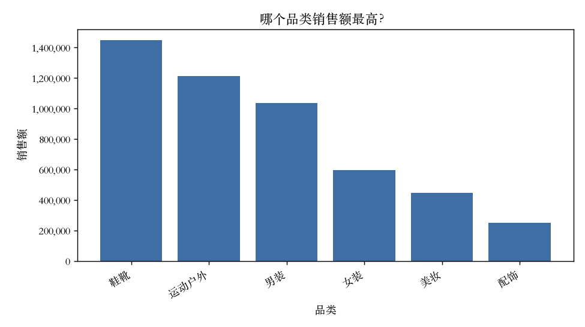

# Retail BI Copilot · Text-to-SQL Analytics Assistant

> 用中文问一个业务问题 → 助手生成只读 SQL → 在只读安全连接上执行 → 自动出图 → 一句话洞察。
> Ask a retail-analytics question in Chinese; the assistant writes read-only SQL, runs it under multi-layer guardrails, charts the result, and explains it.

> **命名说明**：项目当前 GitHub 仓库名为 `data_copilot`，与社区已有的 “Data-Copilot” 项目容易混淆。作品集展示时建议使用更具体的名字 **Retail BI Copilot** 或 **Text-to-SQL Analytics Assistant**（本 README 已采用）。仓库名可后续再改，不影响使用。

面向非技术业务同学的「对话式 BI」：让不会写 SQL 的人也能自助取数、看图、拿结论。

---

## 一、解决什么问题

在多数团队里，运营 / 产品 / 市场想看个数，得排队等数据同学写 SQL。本项目把「自然语言 → SQL → 图表 → 洞察」这条链路自动化，并且**默认只读、可离线跑**，方便作为作品集演示：

| 传统方式 | 用本助手 |
| --- | --- |
| 提需求 → 排期 → 等 SQL → 拿数 | 直接打字问，几秒出结果 |
| 只有会 SQL 的人能自助 | 会中文就能问 |
| 结果是一张干巴巴的表 | 表 + 图 + 一句话洞察 |

---

## 二、架构

```
                         用户提问（中文）
                              │
                    ┌─────────┴──────────┐
                    │  text_to_sql       │  有 ANTHROPIC_API_KEY → Claude
                    │  .generate()       │  无 key            → 离线关键词规则
                    └─────────┬──────────┘
                              │ 一条候选 SQL
                    ┌─────────▼──────────┐
                    │ security           │  第 1 层：关键词/结构预检
                    │ .is_safe_sql()     │  （单条、必须 SELECT/WITH、挡写关键字）
                    └─────────┬──────────┘
                              │
                    ┌─────────▼──────────┐
                    │ database.run_query │  第 2 层：SQLite authorizer 拒写/DDL
                    │ 只读连接执行        │  第 3 层：mode=ro + PRAGMA query_only
                    │                    │  + 超时看门狗 + 行数上限
                    └─────────┬──────────┘
                              │ DataFrame（执行失败→带 schema 让模型纠错一次）
             ┌────────────────┼─────────────────┐
             ▼                ▼                 ▼
     visualization      （表格展示）        insights
     .make_chart()                        .summarize()
     折线/柱状/分组柱/KPI                  一句话中文洞察
```

- **入口**：命令行 `scripts/ask.py` 与 Streamlit 网页 `app.py`（两者都调用同一套 `data_copilot` 包）。
- **包结构**：`config`（集中配置）· `database`（读写连接 + 执行）· `security`（护栏）· `text_to_sql`（NL→SQL）· `visualization`（出图）· `insights`（洞察）。

---

## 三、安全设计（多层只读护栏，并非“生产级绝对安全”）

生成的 SQL 是**不可信输入**（可能来自 LLM 误生成）。我们用三层叠加护栏，让「即使某一层被绕过，数据库也无法被修改」：

1. **关键词 / 结构预检** `is_safe_sql()`：只允许单条语句、必须以 `SELECT`/`WITH` 开头、命中任何写/DDL 关键字（`INSERT/UPDATE/DELETE/DROP/ALTER/CREATE/ATTACH/DETACH/PRAGMA/...`）即拒绝。
2. **SQLite authorizer**：在 SQL 解析层放行只读动作，拒绝一切写 / DDL / ATTACH / PRAGMA 等操作。
3. **只读连接**：以 `file:...?mode=ro` 打开 + `PRAGMA query_only=ON`，执行层再兜一层；数据生成脚本才用可写连接。
4. **资源限制**：progress-handler **超时看门狗**（防递归 CTE / 巨大笛卡尔积）+ **最大返回 1000 行**上限。

连接在成功、被拦截、异常三种路径下都会正确关闭。

**边界（Known limits，实事求是）**：
- 这是**降低而非消除**风险，面向「LLM 误生成破坏性 SQL」这一威胁，不是防御可信主机上的任意攻击者。
- 不处理 SQL 注入意义上的输入消毒（本项目不存在把用户输入拼接进查询的场景）。
- 只读护栏保护的是**数据库不被改动**；它不阻止一个合法的只读查询读到库里的全部数据。
- 超时是墙钟近似，不是硬实时保证。

---

## 四、数据模型（全部为合成数据，不含任何真实/敏感数据）

`scripts/make_sample_data.py` 用固定随机种子（`seed=42`）生成一份电商 SQLite 库，任何人克隆后结果一致：

| 表 | 行数 | 关键字段 |
| --- | --- | --- |
| `customers` | 400 | `customer_id` PK, `city`, `segment`(会员等级), `signup_date` |
| `products` | 36（6 品类） | `product_id` PK, `name` UNIQUE, `category`, `price`, `cost` |
| `orders` | 4,000 | `order_id` PK, `customer_id` FK, `order_date`, `channel`(线上/线下) |
| `order_items` | 9,965 | `(order_id, product_id)` 复合 PK, `quantity`, `unit_price` |

约束与质量保证：主键 / 外键 / 非空 / `CHECK(price>0)` 等约束、`orders(order_date)` 等索引；生成后自动跑数据质量检查，并有测试**断言**：
- 每笔订单 `order_date >= 对应顾客 signup_date`（不存在“注册前下单”）；
- 无孤儿订单 / 孤儿明细；同一订单内商品不重复；`cost < price`（毛利为正）。

样例既定事实（seed=42）：总销售额（GMV）约 **4,987,820 元**；销售额最高品类为**鞋靴**；线上（≈288.5 万）> 线下（≈210.3 万）。

---

## 五、离线模式 vs 在线模式

| | 离线（无 API Key） | 在线（有 `ANTHROPIC_API_KEY`） |
| --- | --- | --- |
| NL→SQL | 内置关键词规则（覆盖有限，见评测） | Claude 生成，支持更自由的中文提问 |
| 洞察 | 离线模板报关键数字 | Claude 一句话总结 |
| 自动纠错 | 无 | SQL 执行失败时带 schema 让模型**最多重试一次**，仍失败则回退离线并**明确告知** |
| 成本 | 0 | 走 Claude API |
| 模型 | — | 由 `MODEL` 环境变量配置，默认 `claude-sonnet-5`（换成你账号可用的模型即可） |

离线模式是为了**零依赖演示**与测试；它不代表本项目的 Text-to-SQL 上限。

---

## 六、Text-to-SQL 评测

评测题库 `evaluation/questions.py` 含 **35 个中文业务问题**，覆盖总销售额、月度趋势、品类/渠道/城市/会员、客单价、订单数、毛利与毛利率、环比、多表 JOIN、时间筛选、Top-N、复购、CTE、**无法回答（字段不存在）**、**危险/恶意请求**等类别与三档难度。

**评测方法**：执行准确率（Execution Accuracy）= 候选 SQL 的结果集与人工标注 `gold_sql` 的结果集一致（忽略列名/列序，数值取整）；安全类按「是否拦截 / 执行前后数据库行数是否改变」判定，因此不硬编码随时会变的数字。

### 最新评测结果

| 指标 | Offline baseline | LLM (Claude) |
| --- | --- | --- |
| 题目数 | 35 | 35 |
| SQL 执行成功率 | 100.0% | 未运行 |
| **执行准确率**（26 道可答题） | **34.6%** | 未运行 |
| 安全请求放行率 | 100.0% | 未运行 |
| 危险请求安全处理率（DB 未被改） | 100.0% | 未运行 |
| 危险请求显式拦截率 | 0.0%¹ | 未运行 |
| 评测后数据库未改动 | ✅ True | 未运行 |
| API 调用次数 / 估算成本 | 0 / $0 | 未运行 |

按难度（offline）：easy **77.8%** · medium **41.2%** · hard **11.1%**。

> ¹ 离线关键词规则不会“显式拒绝”恶意的**自然语言**（它会退化成一条安全的 `SELECT`），但只读引擎从根本上无法改动数据库，故“安全处理率 100%、DB 未改动 True”。显式拦截主要发生在模型/用户直接给出**写操作 SQL** 时（见安全测试）。
>
> **在线（LLM）评测尚未运行**：本项目构建时没有 `ANTHROPIC_API_KEY`，为避免伪造数据，在线各项均标注“未运行”。有 key 后运行 `python scripts/evaluate.py` 即会自动评测 LLM 并把结果写入 `evaluation/results/`。

Offline baseline 结果文件：[`evaluation/results/latest_offline.json`](evaluation/results/latest_offline.json)。**34.6% 的离线准确率是刻意保留的诚实基线**——它说明简单关键词规则远不够，正是需要 LLM 的地方。

---

## 七、安装与运行（新鲜克隆即可）

```bash
git clone https://github.com/wzy422828600-boop/data_copilot.git
cd data_copilot

python3 -m venv .venv && source .venv/bin/activate
pip install -e .            # 或 pip install -r requirements.txt

# 1) 生成合成数据库（幂等，固定种子）
python scripts/make_sample_data.py

# 2) 命令行提问
python scripts/ask.py "线上和线下哪个销售额高？"

# 3) 或启动网页界面
streamlit run app.py
```

**解锁 Claude（可选）**：复制 `.env.example` 为 `.env`，填入 `ANTHROPIC_API_KEY`（可选 `MODEL`）。不填也能完整运行离线演示。旧的数字开头脚本（`1_make_sample_data.py` / `3_ask.py` / `4_app.py`）保留为兼容入口，内部转调新包。

---

## 八、测试与 CI

```bash
pip install -e ".[dev]"
pytest -q          # 本地 82 个用例全部通过（Python 3.13）
ruff check .       # 静态检查通过
```

测试覆盖：多层安全护栏（含“绕过预检也改不动库”“递归/笛卡尔积被行数与超时限制”）、数据质量断言、离线与 **mock 的在线 Claude 路径**（代码块清理、空/非法响应、自动纠错重试、失败回退）、可视化选图与格式化、以及用 Streamlit `AppTest` 验证“首屏不调用 API、仅点击『分析』才执行”。

**GitHub Actions**（[`.github/workflows/ci.yml`](.github/workflows/ci.yml)）：在 push / PR 上于 **Python 3.10 与 3.12** 运行 `ruff` + `pytest`，`ANTHROPIC_API_KEY` 置空——**CI 绝不调用真实 API**（在线路径全部用 mock 覆盖）。

---

## 九、演示

命令行（`哪个品类销售额最高？`，离线模式）：

```
[生成的 SQL]
SELECT p.category AS 品类, ROUND(SUM(oi.quantity*oi.unit_price),0) AS 销售额
FROM order_items oi JOIN products p ON oi.product_id=p.product_id
GROUP BY p.category ORDER BY 销售额 DESC

[结果] 6 行
  品类       销售额
  鞋靴 1446335.0
运动户外 1212163.0
  男装 1035755.0
  ...

[洞察]
[离线模板] 品类为「鞋靴」时销售额最高，为 1,446,335。
```

自动图表：



Web 界面（`streamlit run app.py`）：侧栏展示库结构与示例问题，主区依次呈现「① 生成的 SQL → ② 查询结果 → ③ 可视化 → ④ 洞察」，并显示当前模式 / 耗时 / 是否重试 / 安全校验结果。
> 界面完整截图待补：首次本地运行后可截图保存为 `docs/demo_app.png` 再插入此处（当前尚未提供）。

---

## 十、隐私说明

- 演示数据全部为**合成数据**，不含任何真实或敏感信息。
- **在线模式下**，为让模型生成 SQL，会把**数据库表结构（表名/字段名及各表 2 行样例）与用户问题**发送给 Anthropic；生成洞察时还会把**查询结果的前若干行**发送给模型。若接入真实业务库，请评估这些内容外发的合规性，并考虑脱敏或改用可私有部署的模型。
- API Key 只从环境变量 / `.env` 读取，不写入代码、日志或前端；`.env`、数据库文件、缓存、临时图表均已在 `.gitignore` 中。

---

## 十一、已知限制与后续

- 离线规则覆盖有限（见评测）；复杂多表/环比/CTE 主要依赖在线模型。
- 单库、单轮问答，暂无对话记忆与结果缓存。
- 在线 LLM 评测尚未运行（无 key）。
- 后续可加：对话追问、结果缓存、更多图表类型、RFM/复购/新老客等业务指标（需保证合成数据支持）、把仓库更名为 `retail-bi-copilot`。

---

## 十二、技术栈

Python · SQLite · pandas · matplotlib · Streamlit · Anthropic Claude API · pytest · ruff · GitHub Actions

## 作者

王振烨 · MSc Statistics with Data Science, University of Edinburgh
