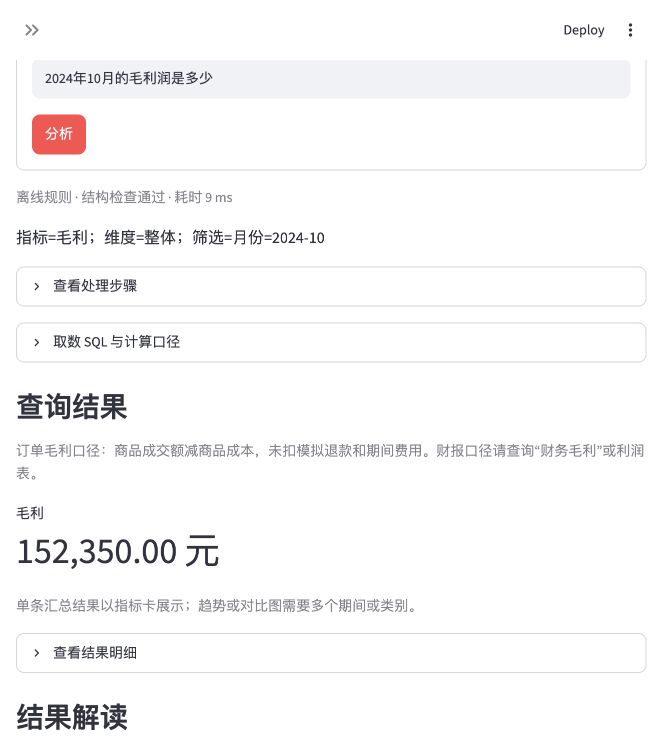

# 零售经营与财务分析助手

版本0.5.0。面向模拟零售企业，提供订单取数、月度财报查询和描述性的变化分析。默认离线，未使用真实公司财报，没有在线模型效果或真实用户收益数据。代码与自动测试由AI实现。

## 打开与体验

本机已配置环境时，可双击项目内 `启动离线助手.command`（macOS）。入口会准备模拟库、跳过邮箱提示、关闭遥测，并将本进程 API key 置空。助手已运行时，重复启动会打开现有页面。浏览器地址：`http://127.0.0.1:8517`。首次启动的终端需保持打开；Control+C 停止。

从 GitHub 下载后的首次运行（Python 3.10 及以上，默认离线，不需要 API key）：

```bash
git clone https://github.com/wzy422828600-boop/data_copilot.git
cd data_copilot
python3 -m venv .venv
source .venv/bin/activate
python -m pip install -e ".[dev]"
python scripts/make_sample_data.py
python -m streamlit run app.py --server.address 127.0.0.1 --server.port 8517 --server.headless true --browser.gatherUsageStats false
```

Windows 可使用 `py -m venv .venv` 创建环境，再在 PowerShell 中执行 `.venv\Scripts\Activate.ps1` 激活；其余 Python 命令相同。启动后在浏览器访问上述地址。模拟数据库不入库，由脚本在本地生成。



单个汇总值展示为带单位的指标卡；表格高度随记录数调整，不同单位的图表指标可分别选择，SQL 和明细可按需展开。

页面分为“问数据与分析”“模拟财务报表”“数据与指标口径”。财报页可以切换月份，查看利润表、资产负债表、现金流量表和简化权益变动表，导出UTF-8 CSV。

可以更换以下问句中的期间或指标：

- `净利润为多少`：默认最新完整模拟月2026-10，并显示期间。
- `今年营业收入和净利润分别是多少`：显示截至10月的累计，不冒充全年。
- `2026年第一季度和第二季度净利润对比`：按照相同季度跨度比较。
- `2026年10月资产负债率和流动比率`：期末余额参与计算。
- `最近三个月净利润趋势`：逐月展示，不将月度比率简单平均。
- `2026年10月净利润为什么下降了`：按实际变化回答；本数据中净利润实际略增。
- `销售额为什么下降了`：两期指标、订单数/客单价拆解、渠道和品类贡献。
- `为什么2026年10月净利润与经营现金流不一致`：逐项列出非现金费用及营运资金调整。
- `2026年10月营业收入为什么不等于销售额`：对照成交额、退款与报表收入。
- `2026年10月利润表`：直接查看该期报表。

## 数据结构与来源

全部为固定种子生成的模拟数据，不对应真实企业。历史2023—2024年订单、顾客和商品逐行保留，追加2025-01至2026-10订单；共400名顾客、36件商品、11,557笔订单、28,957条订单明细。

| 表 | 粒度与用途 |
| --- | --- |
| customers / products | 顾客与商品主数据 |
| orders / order_items | 一笔订单 / 一笔订单中的一种商品 |
| order_finance | 一笔订单的成交额、退款、成本、成本转回、物流与支付费用 |
| financial_accounts | 64个报表及补充分析项目，含报表类型、父小计、流量/余额属性、展示顺序 |
| financial_values | 一个月×一个报表项目，金额以整数分保存 |
| simulation_metadata | 虚构企业名称、币种、期间、版本与模拟假设 |

财报覆盖46个月（2023-01至2026-10），另有2022-12期初资产负债记录。`financial_values`共2,963条。报表结构参考[财政部公开的一般企业财务报表格式](https://kjs.mof.gov.cn/zhengcefabu/201905/t20190510_3254992.htm)，并作教学简化，不声明满足全部法定列报要求。

## 三类计算规则

1. **流量**：收入、费用、净利润和现金收支按选定月份累计。
2. **余额**：资产负债及期末现金取期末；期初项目取最早月份的期初值，不能跨月相加。
3. **比率**：根据所选期间的分子分母重新计算。净利率、毛利率及费用率用期间收入作分母；资产负债率和流动/速动比率用期末余额。速动资产在此定义为货币资金加应收账款。

金额输出以元为默认，可明确提问万元或亿元。百分比变化以百分点展示；比较期非正、分母为0、缺少科目或月份时不伪造增长率或补0。

订单销售额为退款前成交额；财报营业收入扣除模拟退款。订单毛利/毛利率保留原订单口径；查询财报毛利请注明“财务毛利”或查看利润表。销售/管理费用明细和小计不可再次相加。

## 分析怎样形成

- 销售额变化采用对称分解：订单数变化×两期平均客单价，加上客单价变化×两期平均订单数。金额与总变化对齐。
- 渠道、品类分别对照总变化，两个切面不能重复相加；抵消可导致贡献占比为负或超过100%。
- 净利润变化按收入、成本、各类费用与所得税变化逐项对照，不重复计算费用明细与小计。
- 利润到经营现金流按折旧、筹资利息分类、应收、存货、应付及应交税费调整。

这些是数值解释，不证明促销、竞品或市场环境造成变化。普通取数结果的结构检查也不等于语义正确率。

## 模拟假设与能力边界

模拟单体零售企业，未模拟增值税、合并、外币、租赁、递延税和复杂收入确认；退款归属订单月份，并假设对应成本转回。模拟所得税为正税前利润的25%，借款利率为模拟参数，不代表实际适用税率或融资条件。现金不足时按明确规则融资并记入短借与筹资现金流。

目前支持字典内项目、常见期间表达、组合查询、同比/相邻期间比较及部分经营拆解。使用字典匹配和规则，不是通用自然语言理解；不能承诺任意突击问题都能回答。需要核对显示的期间与口径。

没有将公司费用分摊给渠道、品类或城市，因此不提供分组净利润。SKU库存件数、浏览转化率、预测、周转/年化等未定义指标会提示边界。完整年度数据不足时不会把累计当成全年。

## 验证与复现

- 289项自动测试通过，ruff通过；包括64个项目的逐项查询、报表勾稽、期间/单位、余额与比率口径、分解合计、缺失数据、只读、网页交互及重复启动处理。此数量为本地开发回归记录，不代表独立评测准确率。
- 46个月的8组数据/勾稽检查全部通过；历史数据逐行保留；从零重建的8张表与当前库逐行一致。
- 原35题开发回归重新通过，真实API调用0。所有这些都是开发验证，不是独立盲测、通用问答准确率或真实企业业绩验证。

```bash
# 已有基础模拟库时：幂等扩展，保留历史数据
ANTHROPIC_API_KEY='' .venv/bin/python scripts/upgrade_demo_data.py
# 新环境：先安装依赖，再从零生成完整模拟库
.venv/bin/python scripts/make_sample_data.py
ANTHROPIC_API_KEY='' .venv/bin/python -m pytest -q
.venv/bin/ruff check .
ANTHROPIC_API_KEY='' .venv/bin/python scripts/evaluate.py
```

在线实验仍需显式配置key和实际可用的模型ID、主动启用；只针对原有取数分支生成SQL。财报计算和经营拆解始终在本地执行，不因配好key就变成通用财务顾问。真实模型评测未运行。

[数据与勾稽验证记录](evaluation/results/financial_upgrade_validation_20261105.json) · [当前35题结果](evaluation/results/latest_offline.json) · [本轮升级说明](docs/财务升级说明-20261105.md) · [学习路线](docs/学习路线.md)

0.4版的30题前后对照和4/30→30/30是旧数据与旧功能边界下的历史开发回归记录；本轮新增财报和诊断能力后，不用旧题中的“应当拒答净利润”等断言衡量新功能，也不将它包装成当前模型准确率。
